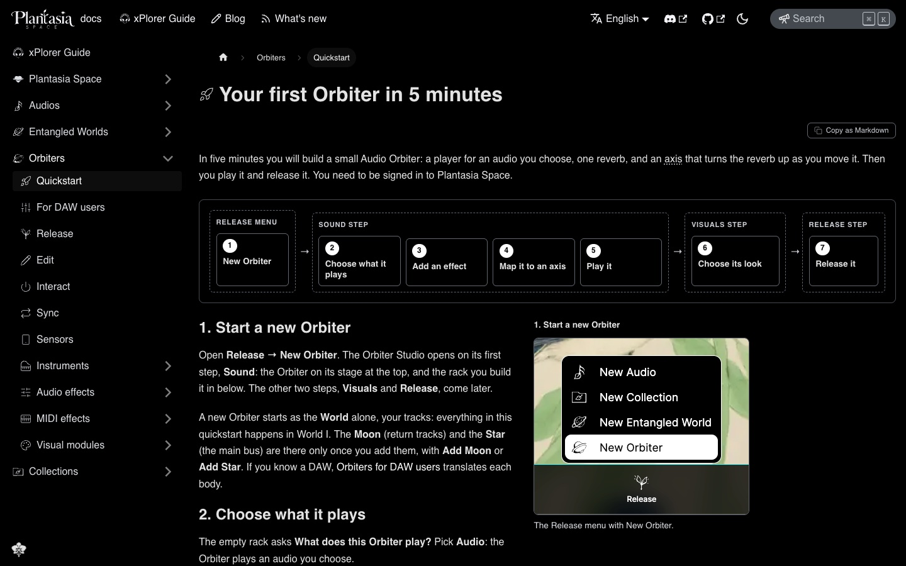
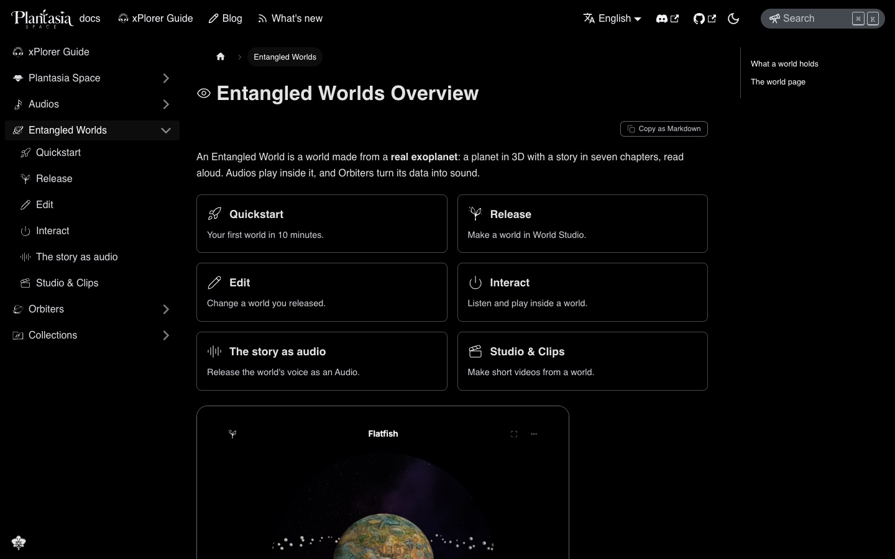

# docs.plantasia.space

The public documentation for [Plantasia Space](https://plantasia.space), *Home for Regenerative Music*: how to listen, make and release worlds, orbiters, audios and collections. In English and Spanish.

**Read it:** [docs.plantasia.space](https://docs.plantasia.space)

<p align="center">
  
</p>

## What's here

- `docs/` — the guides: Plantasia Space, Entangled Worlds, Orbiters (instruments, audio and MIDI effects, sensors, sync), audios, collections
- `i18n/es/` — the Spanish translation, mirroring `docs/`
- `whats-new/` — release notes
- `blog/` — posts
- `src/` — the site's theme, pages and components
- `static/img/` — icons and screenshots; larger captures and videos are served from `herbarium.plantasia.space`

<p align="center">
  
</p>

Built with [Docusaurus](https://docusaurus.io/).

## Run it locally

```bash
npm install
npm run start:no-proxy   # Docusaurus on http://127.0.0.1:3014
npm run build            # static site into build/ (broken links show up here)
```

## Contributing

Found something wrong or missing? Open an issue or a pull request. A change to an English page should come with the same change under `i18n/es/`.

## Deployment

- `main` → [docs.plantasia.space](https://docs.plantasia.space)
- `dev` → the preview site, before release
